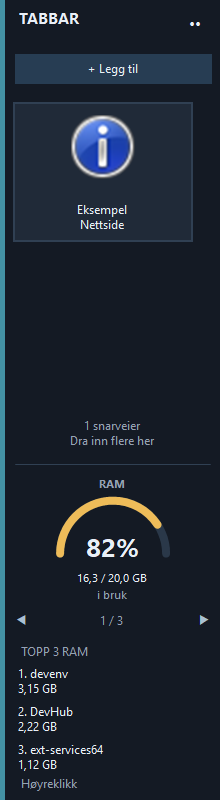
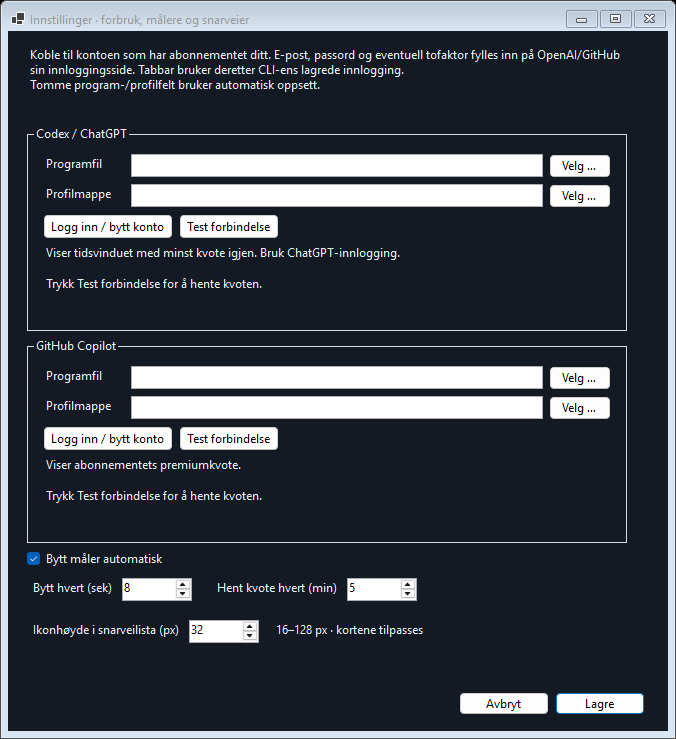
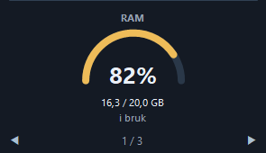
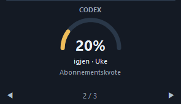
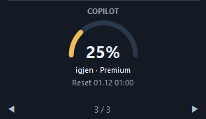

# Tabbar

Windows-toolbar for script, programmer, mapper og nettsider, festet til høyre skjermkant. Standardbredden er 150 fysiske piksler. Dra venstrekanten for å velge 100–600 piksler (maksimalt halve skjermbredden).

## Start

Fra en fersk klone: installer .NET 10 SDK på Windows og kjør `.\Build.ps1` fra prosjektmappen i PowerShell. Det oppretter `dist\1.7.1`; ferdigbygde filer ligger ikke i Git-repoet. Bygget bruker ingen eksterne NuGet-pakker.

Dobbeltklikk deretter `Start-Tabbar.cmd`. Den starter `dist\1.7.1\Tabbar.exe` og aktiverer oppstart ved Windows-pålogging for din bruker. Behold prosjektmappen på samme sted. Start `dist\1.7.1\Tabbar.exe` direkte dersom du ikke vil aktivere automatisk oppstart. Ved kjøring på en annen maskin kreves .NET 10 Desktop Runtime; appen publiseres uten medfølgende runtime.

Toolbaren har en **•••**-meny og et ikon i systemstatusfeltet. Menyen lar deg slå Windows-oppstart av/på, velge skjerm, tilbakestille bredden og avslutte. Avslutning frigjør plassen; oppstartsvalget beholdes.

## Eksempelbilder

Bildene er fra testvisningene i versjon 1.7.1. Kvoteverdiene er eksempeldata; RAM og prosesslisten viser øyeblikksverdier fra testmaskinen.

| Toolbar med snarvei, RAM og prosesser | Innstillinger |
| --- | --- |
|  |  |

| RAM | Codex | Copilot |
| --- | --- | --- |
|  |  |  |

## RAM-måler

Nederst vises en halvsirkelformet måler for hele maskinens fysiske RAM-bruk. Den oppdateres hvert sekund og viser prosent samt brukt/total mengde i GB (1024-baserte enheter, som i Windows). Måleren er turkis under 75 %, gul fra 75 % og rød fra 90 %. Den deler nå et slideshow med Codex og Copilot. Slideshowet blir liggende nederst når snarveilisten rulles eller bredden endres.

Tallene hentes direkte fra Windows via [GlobalMemoryStatusEx](https://learn.microsoft.com/windows/win32/api/sysinfoapi/ns-sysinfoapi-memorystatusex). Dersom en avlesning feiler, vises «Ikke tilgjengelig» frem til neste vellykkede avlesning.

Under måleren vises **TOPP 3 RAM**: de tre enkeltprosessene med størst fysisk minnebruk (working set), sortert fra høyest til lavest. Navn og mengde i MB/GB oppdateres hvert tredje sekund, uten å blokkere grensesnittet. Hold musen over en rad for fullt navn og prosess-ID. Flere prosesser fra samme program vises hver for seg. Delt minne kan inngå i flere prosesser, så tallene er ikke direkte sammenlignbare med summen i måleren.

Høyreklikk en rad og velg **Avslutt prosess …**. Bekreftelsen viser navn og prosess-ID; tvungen avslutning kan miste ulagret arbeid. Kun den valgte prosessen avsluttes, ikke hele prosesstreet. Listen holder valgt prosess fast mens menyen er åpen. Tabbar kontrollerer prosessens oppstartstid før avslutning, slik at en gjenbrukt prosess-ID ikke rammer en annen prosess. Tabbar selv og kritiske Windows-prosesser kan ikke avsluttes herfra. Dersom Windows nekter tilgang, vises en feilmelding; Tabbar ber ikke om administratorrettigheter for dette.

Etter oppdatering: velg **••• → Avslutt Tabbar** og kjør `Start-Tabbar.cmd` igjen. Scriptlisten og innstillingene beholdes.

## Abonnementskvote for Codex og Copilot

På plassen til RAM-måleren vises et **slideshow med RAM, Codex og Copilot**. Codex og Copilot viser **gjenstående abonnementskvote**. Slideshowet starter med RAM og bytter automatisk hvert åttende sekund. Bruk ◀ og ▶ for å bla manuelt; telleren viser hvilken av de tre målerne som vises. Manuell navigering starter nedtellingen på nytt, og bytte pauses mens musen er over slideshowet. Topp 3 RAM står fortsatt under slideshowet. Turkis/lilla betyr mer enn 25 % igjen, gul 11–25 %, og rød 10 % eller mindre. Kvoten hentes når måleren vises første gang og deretter hvert femte minutt, i bakgrunnen (intervallet kan endres i innstillingene). Klikk en måler for å hente på nytt; hold musen over for detaljer og tidspunkt for siste kontroll.

- **Codex:** henter `account/rateLimits/read` gjennom Codex CLI. Dersom kontoen har flere tidsvinduer, vises det med lavest gjenstående prosent. Begge vinduer og nullstilling vises i verktøytipset. Brukerens individuelle grense brukes hvis tidsvinduer ikke rapporteres. Kredittsaldo alene gir ingen prosentvis abonnementskvote.
- **Copilot:** henter `account.getQuota` gjennom Copilot CLI og viser `premium_interactions` med gjenstående prosent. Nullstilling beregnes fra GitHubs månedlige kvoteperiode: den 1. i neste måned kl. 00:00 UTC, vist i lokal tid (01:00 om vinteren og 02:00 om sommeren i Norge). CLI-feltet `resetDate` brukes ikke, fordi enkelte versjoner returnerer hentetidspunktet der. Verktøytipset forklarer beregningen og viser sist kontrollert separat. Ubegrenset abonnement vises som ∞ uten nullstillingstid.

Dette er tjenestenes rapporterte abonnementskvoter, ikke en beregning fra lokalt tokenantall. Innlogget Codex/Copilot CLI må finnes i PATH. Codex som følger med skrivebordsappen oppdages også under `%CODEX_HOME%\packages\app-server-daemon\releases`, eller `%USERPROFILE%\.codex` hvis CODEX_HOME ikke er satt. Copilot installert med WinGet oppdages automatisk. Manglende innlogging, utilgjengelige kvotedata og nettverksfeil vises som «Ikke tilgjengelig»; Tabbar forsøker på nytt automatisk. Kontoer uten en rapportert prosentkvote kan derfor få denne statusen selv om tjenesten fungerer.

Tabbar bruker CLI-enes eksisterende innlogging. Ingen API-nøkler kopieres eller lagres, og kvoteavlesningen sender ingen modellforespørsler. CLI-prosessene startes skjult og avsluttes etter avlesning; tidsgrensen er 30 sekunder. Kvoteavlesningene innebærer nettverkstilgang til tjenestene gjennom CLI-ene.

Dokumentasjon: [Codex App Server](https://learn.chatgpt.com/docs/app-server) og [Copilot usage and billing](https://docs.github.com/en/copilot/how-tos/copilot-sdk/features/usage-and-billing). Nullstillingsregelen er dokumentert for [premiumkvoter](https://docs.github.com/en/copilot/reference/copilot-billing/request-based-billing-legacy/monitor-premium-requests) og [AI credits](https://docs.github.com/en/copilot/concepts/billing-and-usage/individuals/billing). Se også [rapporten om feilaktig resetDate](https://github.com/github/copilot-sdk/issues/2619).

Den isolerte testen `dist\1.7.1\Tabbar.exe --quota-test` kontrollerer kvoteberegning, ubegrenset/manglende/tom kvote, automatisk/manuell navigering, innstillingslagring, ikonhøyder og layout ved 95, 145 og 295 piksler. Resultater skrives til `quota-test-results.txt`, og visningen til `slideshow-*.png`, `gauge-settings.png` og `shortcut-icons-*.png`. Testen prøver også ekte kvoteavlesninger, som kan feile i et begrenset kjøremiljø uten profil- eller nettverkstilgang. Ingen samtaler opprettes.

## Innstillinger og innlogging

Åpne **••• → Innstillinger …**. Her kan du:

- Slå automatisk bytte av/på og velge 3–120 sekunder mellom målerne.
- Velge 1–60 minutter mellom kvoteavlesningene.
- Velge **ikonhøyde i snarveilista**, 16–128 piksler (standard 32). Kortene tilpasses høyden. Hvis baren er for smal, skaleres bildet ned for å passe bredden. Endringen gjelder alle snarveier og trer i kraft ved Lagre.
- Velge programfil og profilmappe separat for Codex og Copilot. Tomme felt bruker automatisk oppsett. Endringene lagres sammen med de øvrige innstillingene.
- Trykke **Logg inn / bytt konto**, fullføre tjenestens innlogging i nettleseren/CLI-vinduet og deretter trykke **Test forbindelse**. Testen bruker feltene i dialogen, også før du lagrer. Den sender ingen modellforespørsler.

E-post, passord og tofaktor fylles inn hos OpenAI/GitHub gjennom tjenestens innlogging. Tabbar lagrer ikke disse. CLI-en håndterer innloggingstokenet. Bruk ChatGPT-kontoen med Codex-abonnementet og GitHub-kontoen med Copilot-abonnementet. Innloggingsknappen starter `codex login` eller `copilot login` med den valgte profilen. En kontoendring gjelder også andre programmer som bruker samme CLI-profil, og fullført innlogging består selv om innstillingsdialogen avbrytes.

Codex-profilen angis via `CODEX_HOME`, Copilot-profilen via `COPILOT_HOME`; dette settes bare for prosessene Tabbar starter. Ingen globale miljøvariabler endres. For å bruke standardinnloggingen du allerede har, lar du profilfeltet være tomt.

## Snarveier

**+ Legg til** og **•••**-menyen har egne valg for program/script, mappe og nettside:

- **Programmer:** `.exe`-filer åpnes med vanlige brukerrettigheter som standard. Administrator kan aktiveres per program. Programmets egen mappe er standard arbeidsmappe.
- **Mapper:** åpnes i Filutforsker. Dra mapper inn i toolbaren eller bruk **Legg til mappe …**.
- **Nettsider:** velg **Legg til nettside …** og skriv en fullstendig `http://`- eller `https://`-adresse. Den åpnes i standardnettleseren. Andre adresseprotokoller godtas ikke.
- **Windows-snarveier:** `.lnk`-filer åpnes gjennom Windows og beholder egne mål, argumenter og innstillinger. Snarveifilen må bli liggende der den ble lagt til.
- **PowerShell:** `.ps1`-filer kjøres med Windows PowerShell 5.1 og får samme logging, kjørestatus, administratorvalg og dobbeltstartsperre som batchscript. Windows sin execution policy beholdes; en blokkert kjøring vises i loggen.

Programmer, script, Windows-snarveier og mapper kan dras inn i toolbaren. Duplikater ignoreres. Nettsider legges til via menyen. Alle typer støtter eget navn, ikon og rekkefølge. Logger og kjørestatus gjelder script; andre snarveier viser typen sin og tidspunkt for siste åpning i verktøytipset. Programmer kan åpnes flere ganger.

Eksisterende batchoppføringer og innstillinger beholdes ved oppdatering.

## Script

- Dra én eller flere `.bat`-, `.cmd`- eller `.ps1`-filer inn i toolbaren, eller velg **+ Legg til → Legg til program eller script …**. Filene vises som ikoner med filnavn. Å legge til et script kjører det ikke.
- Klikk et ikon for å kjøre scriptet. **Kjør som administrator** kan slås av/på per script fra høyreklikkmenyen eller egenskapsdialogen. Standard er på, også for eksisterende oppføringer. Med administratorvalg på viser Windows UAC-dialogen for godkjenning (eller administratorpålogging). Avbryt avslutter bare denne scriptstarten og beholder forrige resultat. Toolbaren kjører fortsatt med vanlige brukerrettigheter, slik at dra og slipp fungerer.
- Windows-skrivebordet er standard arbeidsmappe. Eventuelle hjelpescript som refereres med relative stier, kan ligge på skrivebordet. Windows sin faktiske skrivebordsmappe brukes, inkludert OneDrive-omdirigering. Menyvalget **Åpne skrivebordet** åpner riktig mappe.
- Alternativt: Høyreklikk et ikon og aktiver **Bruk filens mappe som arbeidsmappe**. Da kan hjelpescriptene ligge sammen med hovedscriptet.
- I batchfiler kan `call "%~dp0hjelpescript.bat"` alltid brukes for å finne et hjelpescript ved siden av hovedscriptet, uansett arbeidsmappe.
- Scriptvinduet beholdes åpent som standard, slik at resultat og feil kan leses. Trykk Enter etter fullført kjøring for å lukke vinduet. Slå av **Behold scriptvindu åpent** for automatisk lukking når scriptet er ferdig.
- Høyreklikk for å flytte opp/ned eller fjerne en oppføring. Fjerning sletter ikke originalfilen. Originalfilene må bli liggende der de var da de ble lagt til.

Innstillinger og rekkefølge lagres i `%LOCALAPPDATA%\Tabbar\settings.json`. Kun én forekomst kjører per Windows-økt. Det er ingen innkommende nettverkstjeneste eller egen datainnsamling; kvoteavlesningene bruker tjenestenes CLI-er.

## Navn og ikoner

Høyreklikk en snarvei og velg **Egenskaper (navn og ikon) …**. Her kan du endre visningsnavn og velge eget ikon/bilde (`.ico`, `.png`, `.jpg`, `.jpeg` eller `.bmp`). For script og programmer kan du også velge administratorrettigheter og arbeidsmappe. **Standardikon** gjenoppretter standardikonet. Endring av navn påvirker bare teksten i toolbaren, ikke originalfilen.

Egne bilder kopieres som PNG til `%LOCALAPPDATA%\Tabbar\icons`. Originalbildet kan deretter flyttes eller slettes.

## Kjørestatus og logg

- Knappen viser **Klar** eller **Kjører …**. Når scriptet eller terminalvinduet avsluttes, går knappen tilbake til **Klar** med vanlig farge, uansett avslutningskode. Hold musen over knappen for tidspunkt, rettigheter og arbeidsmappe. En originalfil som mangler, vises fortsatt som **Mangler fil**.
- Samme script kan ikke startes på nytt mens det kjører. Sperren fungerer også når toolbaren er startet på nytt mens scriptet fortsatt kjører. Andre script kan kjøre samtidig. Statusen gjelder hovedscriptet; programmer det starter separat kan fortsette etter at hovedscriptet er ferdig.
- **Klar** vises når scriptet avsluttes, selv om konsollvinduet fortsatt står åpent. Da kan scriptet kjøres på nytt. Lukking av terminalvinduet gir ingen feilmarkering på knappen. Avslutningskoder beholdes i loggen. Hvis toolbaren ble lukket under kjøring, hentes resultatet ved neste oppstart.
- Høyreklikk og velg **Vis siste logg …**. Vinduet oppdateres automatisk under kjøring. **Åpne loggmappe** viser også tidligere kjøringer. Loggene inneholder tidspunkt, arbeidsmappe, vanlig tekstutskrift, feilmeldinger og avslutningskode, og lagres i UTF-8 under `%LOCALAPPDATA%\Tabbar\logs`.
- Loggvinduet viser inntil de siste 256 KiB, slik at store logger ikke gjør grensesnittet tregt. Hele loggen beholdes på disk. Loggene slettes ikke automatisk.

Logging fanger stdout og stderr fra konsollprogrammer. Egne grafiske vinduer logges ikke. Utskrift fra separat startede bakgrunnsprosesser tas ikke videre med dersom de holder utskriftsstrømmene åpne etter at hovedscriptet er ferdig. Programmer som krever direkte tilgang til konsollens skjermbuffer kan trenge tilpasning når utskriften logges.

Toolbaren bruker Windows AppBar for å reservere arbeidsområde, slik at vanlige maksimerte vinduer stopper ved kanten. Den følger oppgavelinjens reserverte plass og kan derfor slutte over oppgavelinjen. Ekte fullskjerm, som spill og videovisning, følger Windows sin fullskjermoppførsel og kan dekke toolbaren.

## Bygg og test

Krever Windows og .NET 10 SDK. `Build.ps1` gjenoppretter og publiserer appen til `dist\1.7.1`. Lokale byggeutdata og testresultater ignoreres av Git; utvalgte eksempelbilder ligger i `docs/images`.

```powershell
.\Build.ps1
$test = Start-Process .\dist\1.7.1\Tabbar.exe -ArgumentList '--self-test' -PassThru -Wait
Get-Content .\dist\1.7.1\self-test-results.txt
```

Testen kjører ufarlige midlertidige batch- og PowerShell-filer og kontrollerer arbeidsmappe, spesialtegn i filstier, lagring, duplikater, AppBar-plassreservasjon, maksimering, breddejustering og gjenoppretting av arbeidsområdet. PowerShell-testen krever at lokal policy tillater det midlertidige scriptet. Den kontrollerer også mål og startinnstillinger for alle snarveityper, HTTP/HTTPS-validering og bakoverkompatibilitet. Eksterne nettsider og brukerprogrammer åpnes ikke av testen. Den lager også `dist\1.7.1\preview.png`, `shortcuts-preview.png`, `website-add-preview.png` og `website-properties-preview.png`. Avslutt en kjørende Tabbar før testen. Ikke endre skjermoppsettet mens testen kjører.

Hvis testøkten mangler et Explorer-skrivebord, hoppes AppBar- og maksimeringstestene over og merkes `SKIP`. Byggemiljøet der appen ble laget har denne begrensningen. Scriptkjøring og visning av toolbaren er testet der; plassreservasjon og automatisk Windows-oppstart må verifiseres fra en vanlig brukerøkt. Automatisk oppstart aktiveres første gang du kjører `Start-Tabbar.cmd`.

Testen kontrollerer også egne navn/ikoner og innstillinger, administratorvalget, logg under kjøring, stdout/stderr med stor utskrift, feilkoder, dobbeltstartsperre, resultat etter omstart og status i toolbaren etter en faktisk kjøring. Den lager forhåndsvisninger av toolbaren, egenskapsdialogen og loggvinduet. Selve UAC-dialogen og administratorrettighetene verifiseres ved å klikke et script i en vanlig Windows-økt; automatiske tester viser ingen UAC-dialog.

RAM-prosesslisten testes for sortering, automatisk oppdatering og plassering under måleren. Avslutning testes bare på en egen midlertidig `ping.exe`-prosess. Testen kontrollerer også at endret eller ukjent prosessidentitet avvises, og at Tabbar ikke kan avslutte seg selv. `top-ram-95.png`, `top-ram-145.png` og `top-ram-295.png` viser listen ved ulike bredder.

For å fjerne appen: slå av **Start med Windows**, velg **Avslutt Tabbar**, og slett appmappen. Innstillingene kan eventuelt slettes fra `%LOCALAPPDATA%\Tabbar`.

## Lokal konfigurasjon og hemmeligheter

Prosjektet bruker ingen `appsettings`-filer i dag. `.gitignore` utelater `appsettings*.json` og sikkerhetskopier av disse i alle mapper, samt lokale `.env`-filer og private nøkkel-/sertifikatfiler. Ikke legg inn passord, token eller API-nøkler i kildekode, dokumentasjon eller eksempelbilder. Tabbar lagrer brukerinnstillinger utenfor repoet i `%LOCALAPPDATA%\Tabbar`; innlogging håndteres av CLI-enes profiler.

AppBar-grunnlaget er dokumentert av Microsoft: https://learn.microsoft.com/en-us/windows/desktop/shell/application-desktop-toolbars
